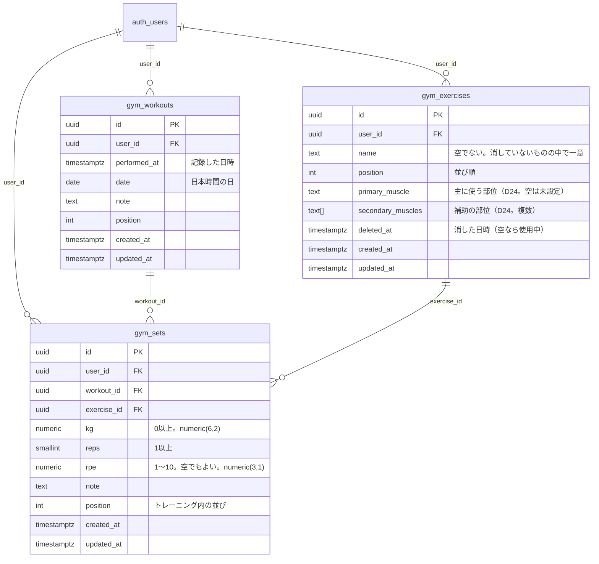

# gymapp の DB スキーマ

筋トレの記録は、関係データベース（Supabase = PostgreSQL）に入っている。姉妹アプリ [maney-app](https://github.com/Keitaro0510/maney-app) と**同じ Supabase プロジェクト**で、テーブル名は `gym_` で始まる。

- 本番の実物から書いた（2026-11-05。`gym_exercises` 18行・`gym_workouts` 40行・`gym_sets` 775行）
- **正本は maney-app の `supabase/migrations/20261105140000_gym_tables.sql`**（マイグレーションは maney-app に置く。D23）。この文書は読むための写し。食い違ったら、マイグレーションが正しい
- 設計の決定は maney-app の `docs/DECISIONS.md` の D23

## ER 図

関係は「トレーニング 1 回 : セット 多」「種目 1 つ : セット 多」。セットが、トレーニングと種目をつなぐ（多対多の中間）。

## テーブル

どのテーブルも次の列を持つ（maney-app の他のテーブルと同じ作法）。

| 列 | 型 | 内容 |
|---|---|---|
| `id` | uuid（主キー） | 既定は `gen_random_uuid()` |
| `user_id` | uuid（`auth.users` を指す） | 持ち主。ユーザーを消すと行も消える |
| `created_at` / `updated_at` | timestamptz | トリガーが決める（アプリは送らない）。`updated_at` は、別端末との競合の検出に使う |
| `position` | integer（既定 0） | 一覧の並び順 |

### `gym_exercises`（種目）

| 列 | 型 | 制約・内容 |
|---|---|---|
| `name` | text | `btrim(name) <> ''`。**消していない（`deleted_at` が空の）種目の中で、同じ人の名前は一意**（部分一意インデックス） |
| `primary_muscle` | text（空可） | 主に使う部位（D24）。下の14の部位のどれか。空は未設定 |
| `secondary_muscles` | text[]（既定 `{}`） | 補助の部位（複数）。同じく14のどれか。**主の部位は入れない** |
| `deleted_at` | timestamptz（空可） | 削除は行を消さず、これを入れる。過去の記録は種目名を出し続ける |

- 一覧に出るのは `deleted_at is null` の種目。記録にだけ残る名前（消した種目・一覧にない名前）も、`deleted_at` 付きの行として持つ
- 消した種目と同じ名前を足すときは、その行の `deleted_at` を空に戻す（過去の記録とつながったままにする）

**部位（D24）**: 値は次の14。DB は `check` で、この一覧にない値と、主の部位を補助にも入れることを断る。

| 値 | 部位 | 値 | 部位 |
|---|---|---|---|
| `chest` | 胸 | `biceps` | 上腕二頭筋 |
| `delt_front` | 肩（前部） | `triceps` | 上腕三頭筋 |
| `delt_side` | 肩（中部） | `forearm` | 前腕 |
| `delt_rear` | 肩（後部） | `abs` | 腹 |
| `lats` | 広背筋 | `glutes` | 臀部 |
| `upper_back` | 僧帽筋・菱形筋 | `quads` | 大腿四頭筋 |
| `hamstrings` | ハムストリング | `calves` | ふくらはぎ |

- 種目名ごとの標準の割り当ては `src/muscles.ts` の `DEFAULT_PARTS`（調べた内容は gymapp の #10）。同じ名前の種目を足すと、部位が最初から入る
- 一覧を増やすときは、maney-app で新しいマイグレーションを書いて `check` を作り直す（`src/muscles.ts` も一緒に直す）

### `gym_workouts`（トレーニング 1 回）

| 列 | 型 | 制約・内容 |
|---|---|---|
| `performed_at` | timestamptz | 記録した（保存した）日時 |
| `date` | date | 端末の日付（**日本時間**）の日。カレンダー・連携で日付を使うために、`performed_at` とは別に持つ |
| `note` | text（既定 `''`） | メモ（今のアプリでは使っていない） |

### `gym_sets`（1 セット）

| 列 | 型 | 制約・内容 |
|---|---|---|
| `workout_id` | uuid | どのトレーニングか |
| `exercise_id` | uuid | どの種目か（今までは名前の文字列で指していた） |
| `kg` | numeric(6,2) | **`kg >= 0`**。2.5kg などの小数を扱う |
| `reps` | smallint | **`reps >= 1`** |
| `rpe` | numeric(3,1)（空可） | **1〜10**。きつさ。空でもよい |
| `note` | text（既定 `''`） | セットのメモ |
| `position` | integer | トレーニングの中での並び（入力した順） |

## 外部キー

`user_id` を含む**複合の外部キー**にして、他人の行を指せないようにしている（`(user_id, id)` に一意制約がある）。

| 子 | 親 |
|---|---|
| `gym_sets (user_id, workout_id)` | `gym_workouts (user_id, id)` |
| `gym_sets (user_id, exercise_id)` | `gym_exercises (user_id, id)` |
| 3 テーブルすべて `user_id` | `auth.users (id)`（`on delete cascade`） |

**`on delete cascade` はセット → トレーニング・種目にはつけていない。** トレーニングを消すときは、先にそのセットを消す（`apply_op` の同じ操作の中で「セット → トレーニング」の順）。`apply_op` が競合を検出できるようにするため。

## インデックス

| インデックス | 用途 |
|---|---|
| `gym_exercises_name_active_key`（一意。`user_id, name`、`deleted_at is null` のみ） | 使用中の種目の名前の重複を防ぐ |
| `*_user_position_idx`（3つ。`user_id, position, id`） | 読み込みの順番と、本人の行の絞り込み |
| `gym_workouts_date_idx`（`user_id, date`） | 日付での絞り込み（カレンダー・連携） |
| `gym_sets_workout_idx`（`user_id, workout_id`） | トレーニングごとのセット、親を消すときの確認 |
| `gym_sets_exercise_idx`（`user_id, exercise_id`） | 種目ごとの集計 |

## セキュリティ（RLS）

- 3 テーブルとも Row Level Security を有効にしてある。ポリシー「本人の行だけ」: `auth.uid() = user_id`（読み書きとも）
- ログインしていない人（`anon`）は何もできない。ログインした人（`authenticated`）には `select / insert / update / delete` だけを許す
- 他の人の行は見えず、書けない（今は使う人が 1 人だが、友人に使ってもらう土台になる）

## トリガー・履歴

各テーブルに 2 つ（maney-app の他のテーブルと同じ）。

- `set_row_timestamps`（insert / update の前）: `created_at`・`updated_at` を決める
- `keep_row_history`（insert / update / delete の後）: 行の履歴を残す

## アプリからの読み書き

- **読み込み**: 3 テーブルを `position, id` の順にページ分け（500件ずつ）で読み、件数が合うときだけ端末の写しを置き換える
- **書き込み**: 直接 insert / update はしない。RPC `apply_op` に「操作」（変更の列。1 回 1〜500 件）を送る。`updated_at` を基準にした競合の検出と、再送の見分け（`applied_ops`）が入っている。同じ名前の使用中の種目を作ろうとすると、競合（`duplicate`）として返る
- **オフライン**: 送れなかった操作は端末に残し（送信待ち）、つながったら順に送る

## 画面の形との対応

| 画面・バックアップ JSON | DB |
|---|---|
| 記録 `{ date, sets }` | `gym_workouts`（`date` ← `performed_at`）＋ `gym_sets` |
| セットの種目 `ex`（名前） | `gym_sets.exercise_id` → `gym_exercises.name` |
| `kg`・`reps`・`rpe`・`note` | `gym_sets` の同名の列（`rpe` は文字から数値に） |
| 種目の一覧（名前の配列） | `gym_exercises` の `deleted_at is null`、`position` 順 |
| 種目の部位（主1つ＋補助） | `gym_exercises.primary_muscle`・`secondary_muscles` |

- バックアップ JSON（`{ app: "gym-tracker-backup", version: 1, … }`）の形は、今までの版と同じ。書き出すとき、行の ID は入れない
- 取り込みのときの「同じ記録」は、日時とセットの中身（種目名・重量・回数・RPE・メモ）で見分ける。同じ記録は足さないので、何度取り込んでも二重にならない

## 他のテーブルとの関係

- 毎日の写しと復元には入る（`private.snapshot_tables()`）。**写しから戻すと、ジムの記録も写しの時点に戻る**（お金だけ戻したいときの手順は maney-app の `docs/db/RESTORE.md`）
- maney-app の JSON の読み込み（`import_backup`）には入らない（読み込みのたびにジムの記録を消さないため）
- お金・予定・タスクのテーブルとは、今は外部キーでつながっていない。Phase 4 で、日付（`gym_workouts.date`）を通して連携する（カレンダーにトレーニングの日、ジム代 ÷ 回数 など）
- 部位（D24）は足した。人体図に今日の負荷を出す（#11）、部位ごとのバランス（#8）が、これを使う
